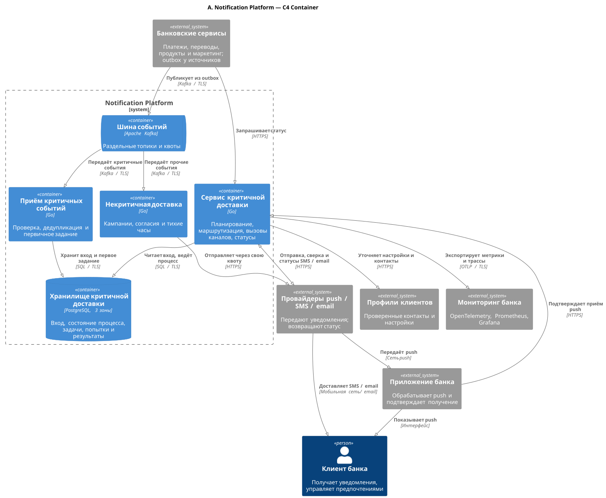
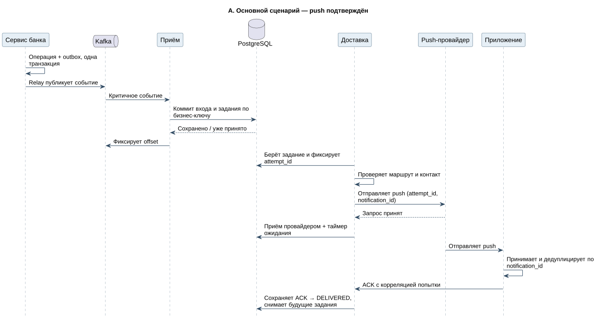
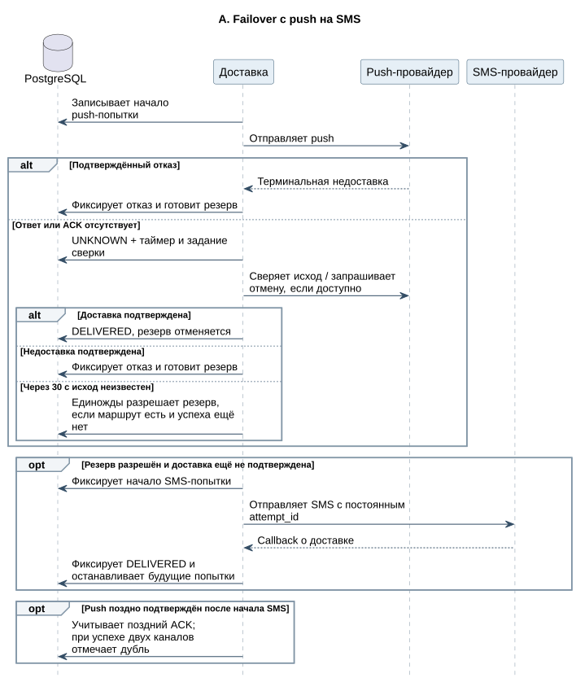
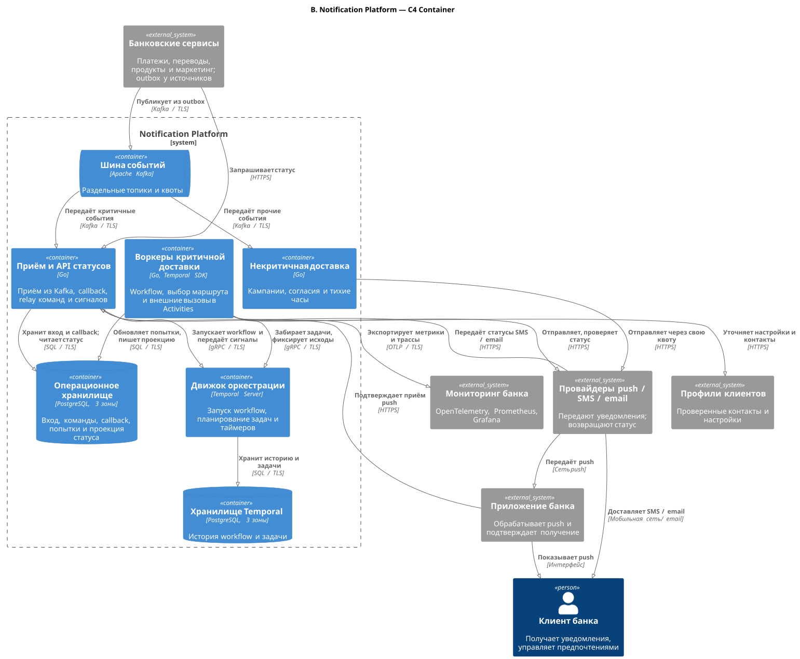
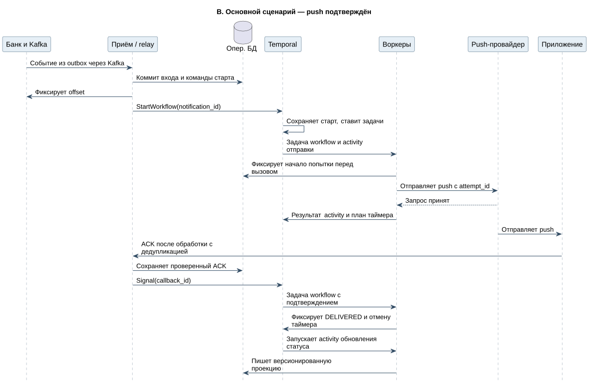
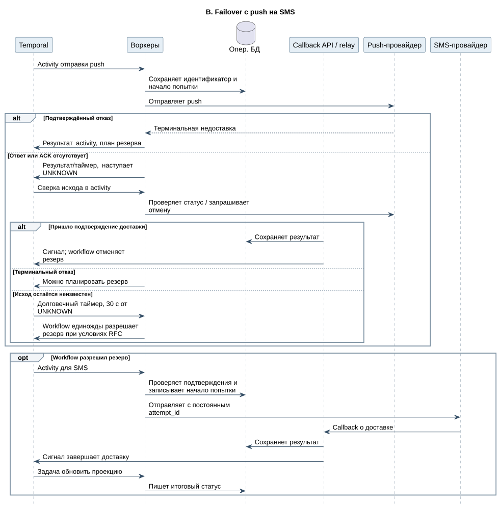

# RFC-004: Гарантированная доставка критичных уведомлений с автоматическим failover между каналами

| Метаданные | Значение |
|---|---|
| **Статус** | DESIGN |
| **Автор(ы)** | Andrew Demenkov |
| **Ответственный** | Владелец платформы уведомлений |
| **Бизнес-заказчик** | Владелец клиентских уведомлений банка |
| **Ревьюеры** | Не назначены |
| **Дата создания** | 2026-11-16 |
| **Дата обновления** | 2026-11-17 |

Ответственный и бизнес-заказчик указаны как роли учебного кейса.

---

## Оглавление

1. [Контекст](#контекст)
2. [Продуктовый анализ](#продуктовый-анализ)
3. [Пользовательские сценарии](#пользовательские-сценарии)
4. [Статистика](#статистика)
5. [Требования](#требования)
6. [Варианты решения](#варианты-решения)
7. [Сравнительный анализ](#сравнительный-анализ)
8. [Выводы](#выводы)
9. [Связанные задачи](#связанные-задачи)
10. [Приложения](#приложения)

## Контекст

Команды переводов, платежей, банковских продуктов и маркетинга отправляют уведомления самостоятельно. Из-за независимых отправок возникают задержки, дубли и неполные сведения о доставке. Для списаний и переводов пропуск уведомления лишает клиента возможности вовремя заметить незнакомую операцию. Общая платформа ведёт единый статус доставки и автоматически подбирает резерв. Изменение затронет клиентов, команды банковских систем и дежурных операторов.

Подсистема охватывает события списания, подтверждения перевода и другие события утверждённых критичных типов. Она отвечает за прохождение события от outbox банковского сервиса до построения маршрута, попыток, подтверждения и разбирательства. Сервисные и маркетинговые доставки рассматриваются в части изоляции нагрузки. Редактор шаблонов, интерфейс настройки и сегментация маркетинговых кампаний остаются за границей RFC.

## Продуктовый анализ

Пользователю важно быстро узнать об операции, особенно если он её не узнаёт. Командам банка нужен общий способ отправки и проверки результата, оператору — история и причина задержки. Критичные события уходят сразу по имеющимся маршрутам. Для остальных типов пользователь сохраняет возможность отказаться от рассылки и задать тихие часы.

| Цель | Как измеряем результат |
|---|---|
| Рост D30 retention на 15% относительно базы | Сравниваем долю пользователей, вернувшихся на 30-й день, на сопоставимых когортах. В эксперименте с сервисными и маркетинговыми сообщениями критичная доставка работает для обеих групп. |
| Снижение частоты жалоб на 30% относительно базы | Сравниваем жалобы на 100 тыс. получателей до и после запуска. Отдельно смотрим жалобы на недоставку, задержку и дубли по типам сообщений. |
| Доставка критичных уведомлений | Измеряем подтверждения за 5 минут и долю подтверждений по всем принятым событиям. Случаи без рабочего маршрута остаются видны оператору. |
| Контроль стоимости | Следим за SMS-попытками на 100 критичных событий и стоимостью подтверждённой доставки по каналам. При аварии доступность резерва важнее дневной цели по стоимости. |

У проекта нет исходного замера retention, жалоб и качества каналов. Эти цели проверяются на пилоте, а квоты, фактическую задержку и типы подтверждений проверяем с провайдерами до переключения трафика.

## Пользовательские сценарии

| Приоритет | Тип сценария | Действующее лицо | Сценарий |
|---|---|---|---|
| MUST HAVE | Основной | Клиент | После подтверждённого списания клиент получает push. Платформа фиксирует подтверждение приложения, резервные каналы не задействуются. |
| MUST HAVE | Failover | Клиент | Push недоступен или подтвердил недоставку. Клиент получает SMS на подтверждённый номер либо email, если SMS недоступен и пригоден email. |
| MUST HAVE | Неизвестный исход | Клиент | Подтверждение push задержалось. Платформа сверяет результат, ждёт установленное окно и при необходимости один раз использует резерв. |
| MUST HAVE | Нет доступного маршрута | Клиент, оператор | Контакты недоступны. Обязательство остаётся открытым, оператор видит причину, а после появления пригодного контакта платформа повторно оценивает доставку. |
| MUST HAVE | Настройки | Клиент | Клиент выбирает канал, отключает акции и задаёт тихие часы. Платформа учитывает выбор при следующей попытке. Критичные события обходят тихие часы. |
| MUST HAVE | Контроль статуса | Банковский сервис, оператор | Повтор события возвращает тот же ID. По ID доступны статус и история в пределах роли; оператор может возобновить обработку. |
| SHOULD HAVE | Оценка расходов | Владелец платформы | Ответственный смотрит долю SMS и причины переключений по типам событий, чтобы скорректировать квоты или порядок каналов. |

MUST HAVE входит в первый рабочий выпуск. SHOULD HAVE означает желательное расширение, в данном случае отдельный отчёт сверх базовых метрик.

## Статистика

| Показатель | Значение из условия |
|---|---:|
| MAU | 10 млн |
| DAU | 3 млн |
| Peak Concurrent Users | 300 тыс. |
| Уведомления на активного пользователя в сутки | 2 транзакционных, 3 сервисных, 5 маркетинговых |
| Максимальный размер одной кампании | 1 млн получателей |

DAU служит базой суточного объёма. Одновременная активность 300 тыс. пользователей сама по себе не задаёт интенсивность событий. До появления телеметрии принимаем пиковый множитель ×10, средний размер входного события 1 КБ и 1,2 попытки на критичное событие при нормальной работе. Отдельно проверяем массовую кампанию и отказ основного канала. Расчёт приведён в требованиях.

## Требования

FR и NFR соответствуют ФТ и НФТ с теми же номерами из [пунктов 1–7](requirements.md). Для сервисных и маркетинговых уведомлений в RFC описаны правила и границы изоляции, детальная реализация относится к задачам всей платформы.

### Функциональные требования

| № | Приоритет | Обозначение | Требование |
|---:|---|---|---|
| 1 | MUST HAVE | FR1 | Банковская команда может запросить отправку по утверждённому типу и узнать статус по идентификатору. |
| 2 | MUST HAVE | FR2 | Платформа применяет предпочтение, согласия и актуальные подтверждённые контакты. Клиент может отключить сервисные и маркетинговые сообщения. |
| 3 | MUST HAVE | FR3 | Критичное уведомление автоматически направляется в пригодный резерв при отказе. При отсутствии маршрута обязательство сохраняется. |
| 4 | MUST HAVE | FR4 | Повтор запроса соответствует одному логическому уведомлению. Подтверждение доставки прекращает запуск новых попыток, а неопределённый исход обрабатывается по общей политике. |
| 5 | MUST HAVE | FR5 | Платформа обрабатывает кампанию до 1 млн адресатов с учётом согласий и показывает ход обработки. |
| 6 | MUST HAVE | FR6 | Оператор видит статусы, попытки и причину задержки, может повторно запустить обработку под тем же ID. |
| 7 | MUST HAVE | FR7 | Сервисные и маркетинговые сообщения ждут конца тихих часов. Критичные обрабатываются сразу. |

### Нефункциональные требования

| № | Приоритет | Обозначение | Требование |
|---:|---|---|---|
| 1 | MUST HAVE | NFR1 | p99 от записи события в outbox до принятия запроса провайдером ≤ 2 с при проектной нагрузке и здоровом основном канале. |
| 2 | MUST HAVE | NFR2 | RPO = 0 и восстановление обработки ≤ 5 мин при отказе одной зоны. За скользящие 30 дней ≥ 99% валидных критичных событий с доступным подтверждаемым маршрутом имеют подтверждение доставки за 5 мин. |
| 3 | MUST HAVE | NFR3 | До 5 тыс. уведомлений/с суммарно и до 1 тыс. критичных/с на прогоне 30 мин. Кампания до 1 млн обработана за 10 мин до постановки на отправку либо отметки пропуска или отсрочки. NFR1 сохраняется при кампании. |
| 4 | MUST HAVE | NFR4 | 0 повторно созданных уведомлений на том же ключе и 0 новых разрешений на отправку после зафиксированного подтверждения в проверках на гонки и рестарты. В работе цель — < 0,1% подтверждённых доставок одного уведомления через два канала от числа доставленных. |
| 5 | SHOULD HAVE | NFR5 | Не более 12 SMS-попыток на 100 критичных событий в сутки при здоровом push, доступном минимум 95% аудитории, и предпочтении SMS не более чем у 5%. Превышение при аварии видно оператору. |
| 6 | MUST HAVE | NFR6 | 100% критичных уведомлений коррелируются с попытками. Если возраст старейшего готового задания > 30 с держится 1 мин, алерт приходит в пределах 2 мин от начала нарушения. |
| 7 | MUST HAVE | NFR7 | TLS для всех межсервисных и внешних вызовов платформы, проверка webhook, отсутствие полных контактов, токенов и текста сообщения в логах и трассах. |

**Расчёт нагрузок**

| Тип | За сутки по DAU | Среднее в секунду |
|---|---:|---:|
| Транзакционные | 6 млн | 69 |
| Сервисные | 9 млн | 104 |
| Маркетинговые | 15 млн | 174 |
| Всего | 30 млн | 347 |

- При коэффициенте пика ×10 получаем около 3,5 тыс. событий/с, из них около 700 критичных/с. Проектный пик — до 5 тыс./с, из них до 1 тыс. критичных/с с запасом. Верхняя чувствительность при 10 млн активных за день — 100 млн/сутки и около 1 160/с в среднем. С тем же ×10 это 11,6 тыс./с и требует нового теста и увеличения мощности. До измерения ×10 — гипотеза.
- Кампания на 1 млн за 600 с требует потока около 1 667 адресатов/с. Пул кампаний проектируется на 2 тыс. адресатов/с, полный проход займёт около 500 с. Лимит охватывает весь маркетинговый поток, фоновую маркетинговую обработку на время всплеска можно отложить. В общем бюджете планируем до 1 тыс./с критичных, 2 тыс./с кампаний и до 2 тыс./с сервисных и запаса при условии общего лимита 5 тыс./с. Норматив относится к постановке на отправку, пропуску или отсрочке, по фактической доставке действуют квоты.
- При 1,2 отправки на критичное событие проектный поток — порядка 1 200 попыток/с при 1 тыс. входных/с. При массовом отказе push и двух последовательных попытках — порядка 2 000/с без учёта восстановления очереди и запросов статуса. Резервируем по 1 200 вызовов отправки/с для критичных push и SMS (1000 на вход и 20% запаса), квоту сверки оговариваем отдельно. Для восстановления оставшиеся 200 SMS/с дренируют очередь в 60 тыс. попыток за ~5 мин при том же входном потоке. Если резервный канал не даёт такой ёмкости, срок доставки при массовом отказе возрастёт. Нужны ограничители, подтверждённая квота и запрет вытеснять критичные попытки кампанией.
- При 1 КБ на входное событие 30 млн/сутки дают ~30 ГБ/сутки. Kafka за 7 дней при трёх копиях — около 630 ГБ, без накладных расходов, компрессии и служебных топиков. Тридцать дней критичных событий, попыток и истории при 3 КБ на событие — ~540 ГБ логических данных основной БД, до индексов, WAL и реплик. Неподтверждённые события сохраняются отдельно до разрешения. Для Temporal дополнительно оцениваем ~6 млн запусков workflows/сутки, при допущении 15–25 записей истории на обычную доставку — 90–150 млн записей истории/сутки. Размер истории и производительность хранилища нужно измерить.
- Бюджет двухсекундной задержки на здоровом пути — 300 мс на relay + Kafka + вход, 500 мс на проверку маршрута и ожидание доставки внутри платформы, 1 200 мс на запрос провайдеру. Это целевые бюджеты этапов. Критерий приёмки — измеренный сквозной p99.

### Архитектурно значимые требования

| ASR | Приоритет | Условие для подсистемы |
|---|---|---|
| ASR1 · Сохранность и восстановление | P0 | FR1, FR3, NFR2. RPO = 0 после приёма при потере одной зоны. Возврат обработки ≤ 5 мин. Целевое подтверждение за 5 мин для ≥ 99% событий с пригодным маршрутом. |
| ASR2 · Задержка и изоляция | P0 | FR5, NFR1, NFR3. p99 ≤ 2 с до принятия провайдером при здоровом основном канале. До 1 тыс. критичных/с одновременно с другими потоками до суммарных 5 тыс./с. |
| ASR3 · Контроль дублей | P0 | FR4, NFR4. Один логический объект на бизнес-ключ. Цель < 0,1% подтверждённых дублей между каналами. |
| ASR4 · Настройки и стоимость | P1 | FR2, FR7, NFR5. Приоритет доступного предпочтительного канала, экономный порядок по умолчанию, контроль SMS-попыток. |
| ASR5 · Наблюдаемость и защита | P1 | FR6, NFR6, NFR7. История каждого принятого события, оповещение о задержках, защищённая передача и журнал без персональных данных. |

## Варианты решения

### Общие правила доставки

#### Граница гарантии

**Принято платформой** означает, что событие сохранено в журнале входа PostgreSQL с подтверждением синхронной реплики. До этого момента ответственность за восстановление несёт банковский outbox. Kafka подтверждает приём для транспорта, после чего источник может отметить запись опубликованной. Исходное событие хранится 30 дней для сверки и повтора. При остановке разбора данных отставание обнаруживается раньше истечения срока хранения Kafka; сверка добирает отсутствующие идентификаторы из банка.

**Принято провайдером** означает, что внешний API принял запрос. **Доставлено** означает, что платформа получила допустимое подтверждение канала. Для push это ACK приложения после приёма и устойчивой обработки сообщения, для SMS — финальный DLR о доставке на устройство, для email — финальное подтверждение приёма сервером получателя, если контракт провайдера позволяет его отличить от приёма на отправку. Email-сигнал слабее и учитывается отдельно по каналу. Подтверждения не доказывают, что пользователь прочитал сообщение. Полная инфраструктурная гарантия доставки действует в пределах модели отказов и при наличии подтверждённого, доступного маршрута, который способен принять сообщение и дать подтверждение. Потеря всего региона требует отдельного плана восстановления. При недоступности всех каналов обязательство остаётся открытым, а событие видно оператору и повторно обрабатывается после восстановления подходящего маршрута.

Во время пилота знаменатель пятиминутного SLO формируется по валидности события, наличию подтверждённых контактов на момент маршрутизации и внешним сигналам доступности провайдера за окно. Его нельзя определять по полученным ACK. Публикуются также доля подтверждений по **всем** принятым критичным событиям и доля исключений с причинами. Для двухсекундного SLO при нормальной работе фиксируем отметки времени на источнике и на выходе адаптера с проверкой синхронизации часов. Выход за окно и отсутствие принятия учитываются как промахи. Внутренние сбои и очереди из выборки не исключаются.

#### Политика отправки

1. Платформа хранит один `notification_id` на ключ `(producer, event_id, recipient_id, notification_type)`. Повтор возвращает существующий идентификатор. Конфликт данных с тем же ключом уходит в разбор. Источники авторизуются по типам шаблонов. Суммы, номера карт и подробности операции остаются в приложении. В сообщении — короткий текст и безопасная ссылка в приложение при наличии.
2. Маршрут строится из подтверждённых контактов и действующих разрешений. Сначала идёт предпочтительный канал, если он пригоден, затем **push → SMS → email** среди оставшихся. Push дешевле, SMS обычно даёт более быстрый резерв, email остаётся третьим по умолчанию. Критичные типы пользователь не отключает, запрет разрешений ОС и отсутствие подтверждённого контакта учитываются. Сервисные и маркетинговые рассылки соблюдают согласия и тихие часы. Перед каждой новой попыткой проверяется актуальная версия проверенных контактов. При недоступном или просроченном снимке контактов отправка ждёт обновления. Таймеры и проверки используют непрозрачные ссылки на получателя, контакт извлекает адаптер.
3. Попытка получает постоянный `attempt_id`, который передаётся как ключ идемпотентности и идентификатор корреляции. Повтор сетевого вызова с тем же ключом разрешён при поддержке провайдера и внутри его окна дедупликации. Критичный трафик использует провайдеров с проверенным контрактом на корреляцию и сверку. Если с провайдером нельзя надёжно повторять вызов, после возможной отправки платформа только сверяет результат. Клиент push хранит `notification_id` и дедуплицирует повтор внутри приложения. В SMS и email платформа не контролирует интерфейс пользователя.
4. Подтверждения привязываются к попытке через клиентскую ссылку либо через сохранённый ID провайдера. Ранний callback по внешнему ID сохраняется до корреляции. Подпись, допустимое окно времени и совпадение источника с зарегистрированным маршрутом проверяются до перехода состояния. Повторный callback обрабатывается идемпотентно, запоздалый failure не отменяет зафиксированный успех. Поздний успех закрывает обязательство и останавливает ещё не запущенный резерв, а два успеха записываются для аудита и метрик.
5. При исчерпании доступных маршрутов ставится `WAIT_ROUTE`. Первая задержка повтора после перебора каналов — 1 мин, затем экспоненциальное увеличение с разбросом до 30 мин. Обновление контактов и восстановление провайдера ускоряют пересмотр с ограничением скорости. После 24 ч создаётся инцидент, безопасные повторы продолжаются. Незакрытые обязательства не удаляются по TTL. Оператор может инициировать повторную оценку того же ID; ручное закрытие устаревшего события требует причины и отдельного статуса `CLOSED_UNDELIVERED`, которое учитывается как недоставка.

| Результат или дедлайн | Действие |
|---|---|
| Провайдер подтвердил доставку | `DELIVERED`. Отменяем будущие задания. Уже отправленное сообщение отозвать можно только по контракту канала. |
| Подтверждён отказ до отправки, терминальная недоставка либо отмена с гарантией отсутствия поздней доставки | Сразу резерв, если есть маршрут и квота. При уже подтверждённом другом канале резерв не нужен. |
| Таймаут запроса (до 1,2 с на здоровом пути), потеря ответа или ACK не пришёл по таймеру | Таймаут запроса сразу переводит попытку в неопределённую. Для принятого push первая проверка через 8 с, для SMS/email через 120 с, сроки стартуют с принятия. Сверяем статус по `attempt_id`, при возможности запрашиваем отмену, принимаем callback. Без подтверждения недоставки попытка остаётся `UNKNOWN`. |
| Статус всё ещё `UNKNOWN` спустя 30 с от перехода в него | Если критичное событие ещё не закрыто и резерв пригоден, разрешаем ровно одно переключение из неопределённости на один резервный канал. Атомарно фиксируем исключение и больше не начинаем новые отправки, пока есть неопределённая попытка. Сверка продолжается по обеим попыткам. Если второй исход тоже неизвестен, выставляем `WAIT_RECONCILIATION` и уведомляем оператора. |

Результат «таймаут» может означать как потерю запроса, так и потерю ответа после фактической отправки. Без надёжной отмены или окончательного статуса у внешнего канала невозможно одновременно гарантировать мгновенное переключение и единственное видимое сообщение у пользователя. Выбираем ограниченный резерв в пользу доставки. Строгий запрет дублей достижим при окончательном доказательстве недоставки первой попытки и идемпотентных вызовах провайдера. Целевой показатель дублей — наблюдаемая доля двойных подтверждений, которая может недосчитывать дубли без ACK. Инциденты с неизвестным исходом учитываются отдельно. Порог в 30 с и область допустимого исключения требуют подтверждения на пилоте.

Если резерв завершился отказом, а исход основной попытки всё ещё неизвестен, процесс тоже переходит в `WAIT_RECONCILIATION`. Успех любой попытки закрывает доставку. После подтверждения недоставки всех предыдущих попыток процесс может продолжить поиск маршрута. Если доказательств нельзя получить, автоматическая отправка приостанавливается, обязательство остаётся открытым для оператора.

При серии временных ошибок адаптер открывает circuit breaker по провайдеру. Новые попытки обходят этот маршрут до восстановления, а уже запущенные продолжают сверяться по правилам UNKNOWN. Закрытие breaker начинается с ограниченных проб. Для ответов о превышении квоты учитываем указанный провайдером интервал ожидания и выбираем допустимый резерв, если текущий вызов отклонён до отправки. Критичные и фоновые отправки имеют разные квоты и независимые пулы запросов, сверка — собственный ограничитель.

#### Интерфейсы и данные

- Событие банка `NotificationRequested.v1` содержит источник, ID и время события, непрозрачный ID получателя и ID утверждённого шаблона. Система определяет класс по реестру шаблонов. Входной конверт не содержит контакт и подробности операции.
- Внутренний API поиска по бизнес-ключу или `notification_id` возвращает статус, время обновления и канал последнего подтверждения, если оно есть. Доступ ограничен своим источником. Операторский API дополнительно показывает попытки и причины ожидания.
- Результат канала содержит ключ попытки или внешний ID, идентификатор callback, собственный тип события и время провайдера. Адаптер преобразует результат в подтверждение приёма, доставки, окончательного отказа или неизвестный исход. Уведомление и попытка имеют разные идентификаторы, поэтому два канала могут ссылаться на одно бизнес-событие без смешивания результатов.

### Вариант 1 (A). Kafka и машина состояний в PostgreSQL

#### Архитектура

[Исходник C4](diagrams/a-container.puml). Банковские сервисы меняют свои данные и пишут событие в собственный outbox одной транзакцией. Relay публикует событие в Kafka. Используем Apache Kafka в трёх зонах с коэффициентом репликации 3, `acks=all`, `min.insync.replicas=2`, выключенным unclean leader election и идемпотентным producer. Для классов трафика отдельные топики, consumer groups, лимиты производителей и сетевого трафика. Доступ к критичному топику выдаётся одобренным producers. Стабильный ключ партиции для критичного события — хеш бизнес-ключа. Порядок гарантируется только для повторов одного ключа. Правило последовательного показа разных операций пользователя в этот RFC не входит.

Входной сервис и сервис доставки пишем на Go. Входной сервис фиксирует бизнес-ключ, событие и задание первой маршрутизации в одной транзакции PostgreSQL; offset фиксируется после коммита. Входной сервис владеет входным журналом и заданиями приёма. Сервис доставки читает их в отдельном пуле и владеет процессом, попытками, таймерами, callback inbox и API статусов. Они работают с одной выделенной БД **в границах единой подсистемы**. Между контейнерами права разделены по таблицам: приём пишет только свои записи, доставка читает неизменяемый вход и управляет обработкой через свои таблицы. Выбор общей БД здесь сознательный — убрать второй брокерный переход до отправки, ценой общей нагрузки и связанных миграций. Другие продукты банка и маркетинговый контур к этой БД не подключаются.

PostgreSQL разворачивается в трёх зонах с синхронным коммитом минимум в одну из двух резервных реплик и управляемым failover с fencing старого primary; продвижение только реплики, содержащей подтверждённый WAL. При отсутствии пригодной синхронной реплики приём блокируется, а событие остаётся у источника или в Kafka. Метрики через OpenTelemetry в Prometheus и Grafana. Доступ к контактам — через API профилей и ограниченную по времени локальную проекцию с версией; отправку по устаревшему адресу блокируем, если версию или разрешение подтвердить нельзя.

В БД хранится уникальный входной ключ, `delivery_state` с версией и признаком использованного переключения из неопределённости, `delivery_jobs` с временем запуска и арендой и неизменяемая история результатов. Первичное задание переносится из входа в обработку идемпотентной транзакцией. Работники берут небольшие пачки готовых заданий через `FOR UPDATE SKIP LOCKED`, без удержания блокировки при внешнем HTTP-вызове. Для задержки опроса целимся в 50–100 мс на критичном пути. Перед отправкой под блокировкой строки процесса проверяем актуальное состояние и аренду, записываем маркер начала внешнего вызова. Просроченная аренда позволяет подобрать работу. Если вызов мог уже уйти, после рестарта сначала сверяем его исход или используем тот же ключ при допустимом повторе. Завершение от старого владельца аренды не меняет решение о следующей отправке; достоверное подтверждение доставки учитывается через общий обработчик результата независимо от аренды.

Переход, запись истории и следующее задание фиксируются одной транзакцией. Callback API фиксирует входящий результат, обработчик применяет его под блокировкой процесса. Перед отметкой начала отправки проверяются и состояние `DELIVERED`, и подтверждения, которые уже привязаны к попытке, но ещё ожидают обработки. Запись такого подтверждения и разрешение на внешний вызов сериализуются по ID уведомления. После выдачи разрешения остаётся окно гонки с поздним подтверждением, его учитывает политика неопределённости. Индекс готовых заданий и отдельные пулы для отправок и сверок защищают свежий трафик от хвоста повторов. История партиционируется по времени. Число параллельных обработчиков, нагрузка индексов, bloat и число SQL-записей на операцию измеряются на стенде.

#### Основной сценарий

[Исходник sequence](diagrams/a-main.puml). Банк делает коммит с outbox. Kafka доставляет событие. После коммита входа обработчик создаёт попытку и отправляет push. Ответ провайдера фиксирует приём, ACK приложения закрывает доставку. Повтор того же события из Kafka возвращает тот же логический объект.

#### Сценарий failover

[Исходник sequence](diagrams/a-failover.puml). При окончательном отказе push откладывать резерв не нужно. При таймауте сверяем исход и ждём установленный период, после чего разрешаем ограниченный резерв. Планирование резерва атомарно проверяет, что уведомление ещё не доставлено.

#### Выполнение ASR

| ASR | Как выполняется | Что проверяем |
|---|---|---|
| ASR1 | Outbox, реплицируемые Kafka и PostgreSQL, коммит до offset, аренда и долговечные задания | Потеря зоны, остановка между вызовом провайдера и записью результата, дренирование очереди |
| ASR2 | Отдельные критичные очереди, DB-ресурсы, пулы и квоты, короткий путь к отправке | p99 при одновременной кампании, задержка опроса БД, лимиты и работа при отказе |
| ASR3 | SQL-уникальность, версия состояния, атомарное планирование, идентификатор попытки и сверка | Повтор входа, потерянный ответ, истечение аренды, гонка callback с таймером |
| ASR4 | Правила в Delivery Service, проверка разрешений, резерв после отказа и дозирование SMS | Запрет необязательной рассылки, смена контакта, доля SMS |
| ASR5 | Журнал переходов, аудит статусов и ручных действий, подписанные callback, метрики и трассы | Полная история по ID, срабатывание алерта и отсутствие ПД в логах |

#### Этапы реализации

| Этап | Описание | Планируемый срок | Ресурсы | Риски |
|---:|---|---|---|---|
| 1 | Согласовать доказательства доставки и квоты, проверить потерю ответа на стенде провайдеров | 1–2 недели | Backend, QA, владельцы каналов | Отсутствие поиска или отмены, длинные согласования |
| 2 | Подключить outbox/Kafka, разработать SQL-переходы, планировщик, адаптеры и API статусов | 3 недели | 2 backend, SRE на настройку Kafka и БД | Гонки аренды, callback и таймера |
| 3 | Провести нагрузочные проверки и имитацию отказов, запустить теневой приём | 2 недели | Backend, QA, SRE | Горячие индексы, задержка опроса и репликации |
| 4 | Запустить пилот с ограниченным числом типов и когорт, проверить откат | 1–2 недели | Backend, QA, SRE, владелец продукта | Поздние подтверждения и нехватка резервной квоты |

#### Преимущества

- Состояние, журнал и новое задание фиксируются в одной транзакции.
- Короткий путь от Kafka до вызова канала и согласованное чтение статуса из операционной БД.
- Использует Kafka и PostgreSQL без ещё одного кластера оркестрации.

#### Недостатки

- Команда сама поддерживает аренды, восстановление и порядок переходов.
- Общая PostgreSQL требует контроля блокировок, p99 и объёма истории.

### Вариант 2 (B). Kafka и Temporal

#### Архитектура

[Исходник C4](diagrams/b-container.puml). Kafka сохраняет роль общего транспорта и изоляцию классов. Компонент Ingest & Status на Go принимает события в PostgreSQL, создавая входную запись и команду старта workflow в одной транзакции, подтверждает offset после коммита. Релей запускает workflow через Temporal Go SDK со стабильным `workflow_id = notification_id` и запретом повторного использования ID в пределах retention. Потеря ответа о старте приводит к повтору с тем же ID; ответ «уже существует» закрывает эту команду. Входной уникальный ключ сохраняется дольше окна возможного повтора, поэтому очистка истории Temporal не открывает повторный старт уже завершённого бизнес-события. Команды старта и сигналы держатся в передающем журнале до подтверждения получателя.

Self-hosted Temporal с отдельным PostgreSQL для истории и задач, синхронной репликацией и развёртыванием в трёх зонах хранит состояние workflow. Один workflow управляет маршрутом, последовательностью попыток, устойчивыми таймерами, сигналами входящих подтверждений и сверкой. Activities вызывают внешние каналы и сохраняют наружную проекцию статуса. Их попытки могут повторяться. Для внешнего вызова используется постоянный ключ и журнал попыток адаптера, а повтор без доказанной идемпотентности выполняет только сверку. Подтверждённый переход в истории считается источником истины о процессе. Проекция в PostgreSQL обновляется идемпотентно по версии и может отставать. Оператор видит время её обновления, процесс сверки исправляет отклонение проекции.

Callback API сначала сохраняет проверенный результат, relay передаёт его сигналом с `callback_id` в существующий workflow. Дубликаты сигнала игнорируются по ID. При задержке старта сигнал остаётся в журнале. Callback после закрытия workflow сохраняется для подсчёта поздних результатов и сверки статуса, без создания нового workflow. Перед каждым внешним вызовом activity проверяет входной журнал подтверждений и записывает разрешение на попытку в одной транзакции с блокировкой по ID уведомления. Callback использует ту же блокировку. Это уменьшает окно гонки с подтверждением, которое остаётся при отправке через внешнюю систему. Очереди Temporal и воркеры зарезервированы для критичного потока, кампании проходят через отдельный Kafka-пул. Параметры workflow версионируются для детерминированного replay. Для длительно открытого процесса используем Continue-As-New при росте истории, перенося актуальные попытки, дедлайны таймеров и отметки об обработанных сигналах. Неподтверждённый relay может доставить сигнал повторно.

#### Основной сценарий

[Исходник sequence](diagrams/b-main.puml). Ingest фиксирует вход и команду старта; Temporal надёжно планирует activity и сохраняет результат. После ACK приложения проверенное подтверждение передаётся сигналом. Workflow закрывает доставку и обновляет проекцию.

#### Сценарий failover

[Исходник sequence](diagrams/b-failover.puml). Устойчивый таймер позволяет продолжить обработку при рестарте воркера. После подтверждённого отказа запускается резервная activity. Для таймаута применяется та же сверка и тот же порог неопределённости, что в варианте A.

#### Выполнение ASR

| ASR | Как выполняется | Что проверяем |
|---|---|---|
| ASR1 | Outbox, Kafka, журнал команд старта, реплицированная история Temporal и replay | Потеря зоны, потеря ответа StartWorkflow, восстановление таймеров и сигналов |
| ASR2 | Изолированные топики и task queues, отдельная БД Temporal и лимиты внешних каналов | p99 через Kafka и планировщик Temporal, задержка Activity, предел history writes |
| ASR3 | Уникальный бизнес-ключ, один workflow на ID, дедупликация сигналов и тот же ключ activity | Повтор команды старта, потерянный ответ activity и одновременный сигнал с таймером |
| ASR4 | Workflow выбирает маршрут; activity проверяет свежесть контакта, квоты и стоимость | Совпадение политики с A и корректность при смене настроек во время ожидания |
| ASR5 | История workflow, операционная проекция, метрики и защищённый callback | Отставание проекции, поздние результаты, сроки алертов и отсутствие ПД в истории execution |

#### Этапы реализации

| Этап | Описание | Планируемый срок | Ресурсы | Риски |
|---:|---|---|---|---|
| 1 | Проверить контракты провайдеров и развернуть испытательный кластер Temporal | 2–3 недели | Backend, QA, SRE с опытом Temporal | Квоты провайдеров, готовность инфраструктуры |
| 2 | Реализовать workflow, activities, relay сигналов, журнал попыток и проекцию | 3 недели | 2 backend, SRE на кластер и БД истории | Потеря сигнала на стыке, недетерминированный replay |
| 3 | Проверить нагрузку, отказ зоны, продолжение workflow и точность проекции | 2 недели | Backend, QA, SRE | Рост истории, задержка планирования |
| 4 | Запустить пилот по когортам и отработать версионирование workflow и откат | 1–2 недели | Backend, QA, SRE, владелец продукта | Незавершённые процессы на старой версии кода |

#### Преимущества

- Temporal сохраняет ход процесса, таймеры и сигналы при перезапуске.
- Сценарий расширяется дополнительными ожиданиями и ветвлениями в workflow.
- Воркеры планирования и отправки можно масштабировать независимо от входа.

#### Недостатки

- Дополнительный кластер, БД истории и устойчивый переход между приёмом и оркестрацией.
- Нужны версионирование workflow и сверка статуса при отставании проекции.
- Внешние вызовы всё равно требуют идемпотентности и сверки.

## Сравнительный анализ

### Ресурсные требования

Оценки относятся к подготовке и пилоту подсистемы при наличии Kafka и PostgreSQL в банке. Сроки поставки провайдеров и ожидание D30 в оценку не входят.

| Критерий | Вариант 1 | Вариант 2 |
|---|---|---|
| Время реализации | 7–9 недель | 8–10 недель при доступности SRE с опытом Temporal |
| Команда | 2 backend, 1 QA и частичная загрузка SRE | 2 backend, 1 QA и SRE с участием в настройке и эксплуатации Temporal |
| Инфраструктура | Kafka, HA PostgreSQL, пулы приёма и доставки, мониторинг | Kafka, операционная HA PostgreSQL, Temporal с отдельной HA PostgreSQL, воркеры и мониторинг |
| Организационные риски | Команда платформы отвечает за корректность своего планировщика и восстановление | Нужны дежурство для дополнительного кластера и правила обновления долгих workflow |

### Соответствие требованиям

Оценка по проекту. Выполнение числовых целей подтверждается проверками перед запуском и пилотом. FR5 и FR7 обеспечиваются общим контуром платформы в обоих вариантах.

| Требование | Вариант 1 | Вариант 2 |
|---|---|---|
| FR1 | Да — журнал входа и API доставки | Да — журнал входа и API проекции |
| FR2 | Да — политика доставки и проверка контакта | Да — политика workflow и проверка в activity |
| FR3 | Да — SQL-переход и долговечное задание | Да — переход и таймер workflow |
| FR4 | Да, с оговоркой об UNKNOWN — уникальный ключ, блокировка по ID, сверка | Да, с той же оговоркой — один workflow на ID, журнал попыток, сверка |
| FR5 | Да, через общий контур — отдельные топики, приём кампаний и квоты | Да, через тот же контур; кампании не используют Temporal |
| FR6 | Да — операторский API поверх журнала и состояния | Да — история и проекция с отметкой свежести |
| FR7 | Да, через общий контур — фоновые задания учитывают тихие часы | Да, через тот же контур |
| NFR1 | Проверить p99 с опросом и фиксацией заданий в БД | Проверить p99 со стартом workflow и планированием activity |
| NFR2 | Синхронная репликация и восстановление по заданиям; подтвердить SLO | Синхронная репликация обеих БД и replay; подтвердить SLO |
| NFR3 | Изоляция потока; проверить 5 тыс./с и горячие SQL-таблицы | Изоляция потока; проверить 5 тыс./с и очередь Temporal |
| NFR4 | Атомарные разрешения и один ключ; измерить поздние дубли | Атомарные разрешения и дедупликация сигналов; измерить поздние дубли |
| NFR5 | Общая политика порядка и квот; измерить долю SMS | Та же политика в workflow; измерить долю SMS |
| NFR6 | Журнал и алерты по возрасту SQL-заданий | Журнал, метрика возраста и сверка проекции |
| NFR7 | Защита транспорта, проверка callback и аудит логов | Те же меры плюс проверка истории workflow |

### Эксплуатационные компромиссы

| Критерий | A · Kafka + PostgreSQL | B · Kafka + Temporal |
|---|---|---|
| Нормальная задержка | Меньше планирующих компонентов, но включает опрос БД. Если индекс или короткие транзакции деградируют, p99 вырастет. | Ещё один надёжный переход при старте и планировании activity. p99 подтверждается отдельным тестом. |
| Восстановление и развитие сценария | Нужно поддерживать аренды, таймеры, повтор и транзакционные переходы. Плюс — единый запрос к истории и текущему состоянию. | Управление таймерами, replay и сигналами дают готовые примитивы. Нужны дисциплина версионирования и сверка проекции. |
| Операции и масштабирование | Два инфраструктурных слоя, нагрузка на горячие таблицы, обслуживание индексов и очистка истории. | Дополнительный кластер и БД, объём истории и снятие ограничений на число workflow/activities. Можно отдельно наращивать воркеры и сервис Temporal. |
| Дубли и стоимость | Контролируются общим контрактом с провайдерами и SQL-координацией. | Контролируются тем же контрактом и workflow. Replay не гарантирует единственность внешней отправки. |

## Выводы

**Рекомендация — вариант 1 (A), Kafka и PostgreSQL.** Для трёх каналов и фиксированной политики есть ограниченный набор переходов, а основная нагрузка — короткие процессы, поэтому отдельный движок и его история дорого обходятся относительно объёма логики, который они заменяют. A сокращает путь до первого вызова провайдера и упрощает согласованное чтение статуса. Цена выбора — собственное восстановление, проверка гонок и нагрузка на PostgreSQL. Если оптимизация индексов и разделение PostgreSQL на шарды не обеспечат NFR1 и NFR3, либо в процессе появятся многие независимые ожидания и ветвления, вернёмся к варианту 2 и измерим Temporal при том же потоке.

Ключевые ограничения выбора — наличие доступных контактов, квоты и качество доказательств провайдеров, редкие дубли при неопределённом результате, общий ресурс PostgreSQL внутри подсистемы и отсутствие гарантии при потере всех зон региона. Дорогой резерв используется только по правилам и квотам. При отказе, когда SMS-лимита не хватает, возраст сообщений растёт, а оператор видит размер и возраст очереди.

### Внедрение и откат

На теневом прогоне платформа сверяет ID и маршруты без внешних отправок. Пилот начинается с внутренней аудитории и нескольких типов событий. Один банковский тип и когорта в каждый момент принадлежат одному отправителю. Для передачи ответственности используется граница по ключу/времени события: старые записи дочитывает их исходный отправитель, новые получает новый маршрут. При откате платформа сохраняет ответственность за уже принятые ID и дренирует их с прежним ключом. После выполнения SLO увеличиваем долю трафика. Объём, задержка, доля SMS и дублей измеряются, приведённые расчёты являются проектными оценками.

## Связанные задачи

| Задача | Результат и зависимость |
|---|---|
| Проверить контракты push, SMS и email | Зафиксировать доказательства доставки, поддержку ключа повтора, отмены и квоты. Требуется до подключения провайдеров. |
| Подключить outbox первого банковского сервиса | Настроить проверку схемы, сверку ID и правила перехода с прежнего отправителя. Требуется до теневого запуска. |
| Подготовить проверку нагрузки и отказов | Воспроизвести пики, кампанию, потерю зоны и ответы с неизвестным исходом. Условия прохождения есть в приложении. |
| Провести пилот и согласовать порог failover | Оценить задержку, дубли и SMS-затраты, зафиксировать решение до расширения трафика. |

[Описание проекта](README.md) и [требования к платформе и ASR](requirements.md).

## Приложения

### Глоссарий

| Термин | Определение |
|---|---|
| ASR | Архитектурно значимое требование. Влияет на выбор компонентов и их взаимодействие. |
| Outbox | Запись о событии, которую источник сохраняет в той же транзакции, что и банковскую операцию, чтобы впоследствии опубликовать событие. |
| Failover | Переключение на запасной канал доставки. |
| ACK / DLR | Подтверждение приложения или отчёт провайдера о доставке. |
| UNKNOWN | Исход попытки пока нельзя достоверно определить. |
| SLO / p99 | Целевой показатель качества / значение задержки, в которое укладываются 99% измерений. |
| RPO / RTO | Допустимая потеря данных / целевое время восстановления после отказа. |
| Workflow / Activity | В Temporal — долговечный сценарий и отдельная выполняемая в его рамках задача, например вызов провайдера. |

### Метрики и эксплуатационный контроль
 p99 принятия, доля подтверждений за 5 мин, возраст старейшего готового задания, время в `WAIT_ROUTE` и `WAIT_RECONCILIATION`, lag по критичным источникам, доля failover по причинам и каналам, доля неизвестных исходов, поздние подтверждения, число дублей и оплачиваемых SMS. Гистограммы помечаются только классом, каналом, провайдером и исходом. Поиск отдельной доставки — по `notification_id` в защищённом журнале. Оператору доступны роли чтения, повторной оценки и исключительного ручного закрытия, все изменения аудируются. Внутренние вызовы используют mTLS, внешние TLS и проверку подписей, секреты — в Vault, данные и бэкапы шифруются. Онлайн-историю итоговых доставок храним 30 дней, индекс идемпотентности и аудит — не менее 90 дней, больше максимального окна повтора источника. Историю открытых случаев сохраняем до разрешения.

### Проверки перед запуском

| Сценарий | Критерий |
|---|---|
| 30 мин при 5 тыс. событий/с, среди них 1 тыс. критичных/с, кампания на 1 млн | p99 ≤ 2 с в здоровом контуре; кампания разобрана не более чем за 10 мин; маркетинг не использует критичные квоты. |
| Потеря одной зоны или падение после коммита входа, но до подтверждения Kafka | 0 потерянных принятых ID после сверки, обработка возобновляется в пределах 5 мин. |
| Таймаут push до и после фактической отправки, поздний ACK, crash после вызова и повтор события | Нет нового логического уведомления. Подтверждённый отказ вызывает резерв, поздний успех до выдачи разрешения на вызов отменяет резерв. Исключение при неизвестном результате фиксируется единожды. |
| Нет подходящего канала, затем появился подтверждённый контакт | Обязательство остаётся открытым и возобновляется по тому же ID. Таймаут и отсутствие маршрута видны оператору. |
| Смена контакта, повторный или поддельный callback, инцидент с хвостом очереди | Запрещённый контакт не используется. Поддельный callback не меняет состояние. История доступна без ПД, алерт соответствует NFR6. |

### Открытые вопросы и риски

1. Провайдеры и подтверждения. Доступны ли квота резервного канала, корреляция, повтор ключа, конечный статус и гарантированная отмена? Ответ определяет режим failover. Проверить договором и тестами до пилота.
2. Пиковый профиль. Нужна фактическая статистика односекундных пиков и частоты массовых кампаний. Коэффициент ×10, размер сообщения и кратность попыток пересчитать по выгрузке.
3. Допуск на поздний дубль. На пилоте сравнить окно 30 с с реальным распределением поздних ACK и стоимостью. Изменение порога согласовать с владельцем критичных уведомлений.
4. Региональный отказ. Текущая модель охватывает одну зону. Для восстановления после потери региона нужно согласовать RPO/RTO, перенос журналов и стратегию защиты от двойной отправки при переключении региона.

### Ссылки

- [Apache Kafka — репликация, min.insync.replicas и acks](https://kafka.apache.org/42/configuration/topic-configs/).
- [PostgreSQL 17 — выбор доступных заданий через SKIP LOCKED](https://www.postgresql.org/docs/17/sql-select.html) и [синхронная репликация](https://www.postgresql.org/docs/17/warm-standby.html#SYNCHRONOUS-REPLICATION).
- [Temporal — детерминизм и история Workflow](https://docs.temporal.io/workflow-definition), [сигналы](https://docs.temporal.io/encyclopedia/workflow-message-passing), [правила повторов Activities](https://docs.temporal.io/encyclopedia/retry-policies).
- [C4 — диаграмма контейнеров](https://c4model.com/diagrams/container), [PlantUML — командная строка](https://plantuml.com/command-line).
